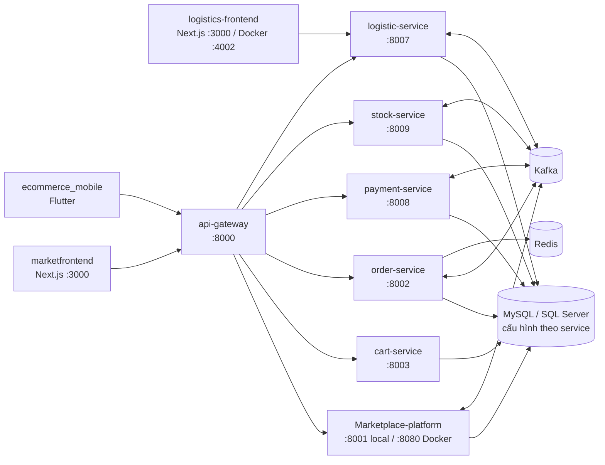

# E-Commerce Marketplace


Trang portfolio mô tả chi tiết một dự án thương mại điện tử theo hướng fullstack/microservices, tập trung vào luồng nghiệp vụ thực tế: voucher, giỏ hàng, checkout, xử lý đơn, hoàn trả và vận hành service Docker.

## Mục lục

- [Tổng quan](#tổng-quan)
- [Demo](#demo)
- [Tính năng nổi bật](#tính-năng-nổi-bật)
- [Công nghệ sử dụng](#công-nghệ-sử-dụng)
- [Hình ảnh giao diện](#hình-ảnh-giao-diện)
- [Kiến trúc và cấu trúc repository](#kiến-trúc-và-cấu-trúc-repository)
- [Chuẩn bị môi trường](#chuẩn-bị-môi-trường)
- [Chạy từng service](#chạy-từng-service)
- [Chạy toàn bộ hệ thống](#chạy-toàn-bộ-hệ-thống)
- [Build, test và Docker](#build-test-và-docker)
- [Tài liệu và SQL](#tài-liệu-và-sql)
- [Thông tin liên hệ](#thông-tin-liên-hệ)

## Tổng quan

Dự án trình bày case study E-Commerce Platform với các nội dung chính:

- Bài toán đồng bộ tồn kho và tránh race condition.
- Luồng mua hàng hoàn chỉnh từ voucher đến thanh toán.
- Luồng xử lý đơn phía nhà bán hàng.
- Luồng xử lý vận đơn phía logistics.
- Luồng trả hàng và hoàn tiền.
- Theo dõi hoạt động của service bằng Docker Stats.
- Tổng hợp các giải pháp kỹ thuật đã áp dụng trong hệ thống.

## Demo

- Website demo: https://nexamart.duckdns.org/
- Mã nguồn (microservice): https://github.com/Thoai1503/Ecommerce_marketplace-Microservice_GithubAction
- Trang giới thiệu dự án trong repository này: `/ecommerce.html`

## Tính năng nổi bật

### 1) Voucher

- Hỗ trợ mã giảm giá theo chiến dịch/sales mùa vụ.
- Dữ liệu voucher đa dạng: loại giảm giá, điều kiện áp dụng, thời hạn, phạm vi áp dụng.


### 2) Giỏ hàng

- Trải nghiệm giỏ hàng liền mạch trên máy tính và thiết bị di động.
- Chuyển giỏ hàng khách thành giỏ hàng người dùng khi đăng nhập hoặc thanh toán.


### 3) Thanh toán

- Tích hợp nhiều phương thức thanh toán.
- Chọn vận chuyển theo kiện hàng.
- Áp dụng voucher và cập nhật tổng tiền theo thời gian thực.


### 4) Theo dõi đơn hàng

- Xem chi tiết đơn hàng và trạng thái vận chuyển.
- Theo dõi từng kiện hàng trong cùng một đơn.

### 5) Xử lý đơn hàng phía nhà bán hàng
- Nhà bán hàng nhận thông báo đơn mới.
- Chấp nhận đơn và nhận mã vận đơn từ đơn vị logistics.
- Quản trị trạng thái đơn và xử lý yêu cầu hậu mãi.

### 6) Dịch vụ logistics tiếp nhận & xử lý kiện hàng

- Đơn vị logistic tiếp nhận thông tin kiện hàng ngay khi người bán xác nhận gửi hàng
- 1 mã vận đơn ứng với kiện hàng sẽ gửi về người bán khi ĐVVC xác nhận đã lấy.
- Nhà bán hàng và người mua có thể dùng mã vận đơn này để tra cứu đơn hàng.

### 7) Quy trình trả hàng

- Duyệt/từ chối yêu cầu trả hàng theo chính sách.
- Thu hồi sản phẩm qua đơn vị logistics.
- Tự động hoàn tiền sau khi xác nhận hàng trả đạt yêu cầu.

### 8) Theo dõi tài nguyên Docker

- Theo dõi tài nguyên và trạng thái các container service trong môi trường Linux VPS.

## Công nghệ sử dụng

### Giao diện

- Next.js
- React 19
- Tailwind CSS
- TypeScript

### Backend và hệ thống

- Node.js
- Java Spring Boot
- Kafka (microservices)
- Redis
- MySQL / SQL Server
- Hibernate

### Hạ tầng

- Docker
- Nginx
- Linux VPS
- GitHub Actions

## Hình ảnh giao diện

### Trang giới thiệu


### Giỏ hàng


### Thanh toán


### Theo dõi đơn hàng


### Quy trình trả hàng


### Thống kê tài nguyên Docker


## Kiến trúc và cấu trúc repository

Repository này gồm nhiều dự án độc lập (backend, giao diện web và ứng dụng di động), không phải một ứng dụng Next.js duy nhất. Sơ đồ dưới đây thể hiện các tích hợp chính tìm thấy trong mã nguồn; URL, Kafka topic và route cụ thể có thể thay đổi theo profile và môi trường:



| Thư mục | Vai trò |
| --- | --- |
| `api-gateway/` | Spring Cloud Gateway MVC, xác thực JWT và định tuyến yêu cầu đến backend. |
| `Marketplace-platform/` | Backend marketplace tổng hợp nhiều nghiệp vụ; đồng thời được `stock-service` sử dụng như một Maven artifact. |
| `cart-service/` | API và tầng lưu trữ dữ liệu cho giỏ hàng. |
| `order-service/` | Đơn hàng, vận chuyển, Kafka subscriber và Redis. |
| `payment-service/` | Thanh toán, giao dịch, tranh chấp, ví, đối soát, hoàn tiền, VNPay và Kafka. |
| `stock-service/` | Xử lý tồn kho và sự kiện cập nhật kho qua Kafka. |
| `logistic-service/` | Vận đơn, phí vận chuyển, thông tin người nhận và quy trình logistics/trả hàng. |
| `marketfrontend/` | Giao diện marketplace Next.js App Router, gồm các trang người dùng và quản trị. |
| `logistics-frontend/` | Giao diện logistics Next.js, gồm tra cứu vận đơn, quản trị và chi tiết vận đơn. |
| `ecommerce_mobile/` | Ứng dụng Flutter; điểm khởi chạy tại `lib/main.dart`, API client và cấu hình trong `lib/core/`. |
| `sql/`, các tệp `.sql` ở thư mục gốc | Lược đồ và tập lệnh SQL; cần xác nhận hệ quản trị cơ sở dữ liệu trước khi áp dụng. |
| `refund_workfolw/` | Tài liệu, migration, tham chiếu API và kịch bản kiểm thử cho quy trình trả hàng/hoàn tiền. |
| `.github/workflows/` | Workflow CI/CD cho giao diện và triển khai backend theo từng service. |

Mã nguồn Spring Boot nằm trong `src/main/java/`, cấu hình trong `src/main/resources/`; các package controller, service, repository/model, DTO và config được tổ chức theo từng service. Hai ứng dụng web đặt route trong `src/app/`. Repository không có Compose ở thư mục gốc để khởi động tất cả dự án và dependencies.

### Cổng và dependencies

| Thành phần | Cổng local trong mã nguồn | Phụ thuộc / ghi chú |
| --- | ---: | --- |
| API Gateway | 8000 | Cần JWT secret; định tuyến đến các backend. |
| Marketplace platform | 8001 | Cơ sở dữ liệu, Kafka/email tùy chức năng; Dockerfile chạy WAR trên Tomcat cổng 8080. |
| Order service | 8002 | Cơ sở dữ liệu, Kafka, Redis và tích hợp thanh toán/logistics. |
| Cart service | 8003 | MySQL. |
| Logistic service | 8007 | MySQL, Kafka; có thể cần nhà cung cấp dịch vụ tính phí vận chuyển. |
| Payment service | 8008 | Cơ sở dữ liệu, Kafka và cấu hình VNPay. |
| Stock service | 8009 | Cơ sở dữ liệu, Kafka; cần build Marketplace artifact trước. |
| Market frontend | 3000 | API mặc định `http://localhost:8000`. |
| Logistics frontend | 3000 | `NEXT_PUBLIC_LOGISTIC_URL` mặc định `http://localhost:8007`. |
| Logistics frontend (Docker Compose) | 4002 -> 3000 | Ánh xạ cổng được khai báo trong Compose riêng của giao diện. |
| Flutter app | — | URL API cấu hình trong `lib/core/constants.dart`; `localhost` trên emulator/device không phải máy phát triển. |

Cổng được lấy từ cấu hình mã nguồn; profile, biến môi trường và Docker có thể ghi đè các giá trị này.

## Chuẩn bị môi trường

- Java 21 cho backend, Node.js/npm theo `package.json` của từng giao diện và Flutter/Dart theo yêu cầu SDK trong `ecommerce_mobile/pubspec.yaml`.
- Cơ sở dữ liệu, Kafka và Redis theo cấu hình từng service. Một số profile `local` vẫn trỏ đến máy chủ bên ngoài; hãy kiểm tra và thay bằng endpoint phát triển của bạn.
- Các backend có Maven Wrapper `mvnw.cmd`; không bắt buộc cài Maven riêng.
- Tạo cơ sở dữ liệu/lược đồ cần thiết trước khi chạy. `ECOMMERCE.SQL`, `wallet-schema.sql`, các tệp trong `sql/` và `refund_workfolw/` phục vụ những mục đích khác nhau; một số là migration/sửa lỗi, không phải lược đồ khởi tạo.

### Lưu ý cấu hình và bảo mật

1. Cấu hình thông tin đăng nhập cơ sở dữ liệu, JWT/payment secret và thông tin nhà cung cấp bằng biến môi trường hoặc secret manager. Không đưa giá trị thật vào lệnh, log, README hay commit.
2. Một số tệp cấu hình/Compose trong repository có giá trị nhạy cảm được ghi trực tiếp. Không dùng nguyên trạng cho production; hãy thay bằng secrets và đổi thông tin xác thực nếu chúng từng bị chia sẻ hoặc commit.
3. `api-gateway/src/main/resources/application.properties` cần `JWT_SECRET`.
4. `marketfrontend/src/middleware.ts` có ghi log một số giá trị cấu hình. Không đưa secret vào `NEXT_PUBLIC_*`; hãy loại bỏ hoặc ẩn thông tin nhạy cảm trong log trước khi triển khai.
5. `.github/workflows/production.yml` có bước in thông tin Docker Hub secrets ra log. Hãy kiểm tra và sửa workflow trước khi sử dụng.
6. Gateway local có route Marketplace đến `localhost:8001`, nhưng route stock trong `api-gateway/src/main/java/docker_test/com/routes/Routes.java` đang hard-code `http://localhost:8084`, trong khi stock service mặc định dùng cổng `8009`. Cần đồng bộ URL trước khi kiểm thử stock qua gateway.

## Chạy từng service

Mở một cửa sổ PowerShell riêng cho mỗi service cần chạy. Trước khi khởi động, hãy cấu hình cơ sở dữ liệu, Kafka/Redis và secrets như hướng dẫn ở trên. Các lệnh Spring Boot dưới đây chỉ chạy ứng dụng, không tự khởi động các dependencies bên ngoài.

### API Gateway

```powershell
cd api-gateway
$env:JWT_SECRET = "<secret-local>"
.\mvnw.cmd spring-boot:run
```

Gateway lắng nghe trên cổng `8000`. Profile local dùng URL localhost cho các backend. Các route cụ thể gồm `/api/orders/**`, `/api/cart/**`, `/api/logistics/**`, `/api/payments/**` và `/api/stock/**`; yêu cầu không khớp route cụ thể sẽ được chuyển đến Marketplace.

### Marketplace platform

```powershell
cd Marketplace-platform
.\mvnw.cmd spring-boot:run
```

Cổng local là `8001`. Để tạo artifact mà `stock-service` phụ thuộc:

```powershell
cd Marketplace-platform
.\mvnw.cmd -DskipTests install
```

### Cart service

```powershell
cd cart-service
.\mvnw.cmd spring-boot:run
```

Cổng `8003`; cần MySQL và datasource có thể kết nối.

### Order service

```powershell
cd order-service
.\mvnw.cmd spring-boot:run
```

Cổng `8002`; cần cơ sở dữ liệu, Kafka và Redis. Kiểm tra cả URL thanh toán/logistics.

### Payment service

```powershell
cd payment-service
.\mvnw.cmd spring-boot:run
```

Cổng `8008`. Cấu hình datasource nằm trong `application.yml`/`application-local.yml`; hãy đặt `DB_HOST`, `DB_PORT`, `DB_NAME`, `DB_USER`, `DB_PASSWORD`, `KAFKA_BOOTSTRAP_SERVERS` và các biến `VNPAY_*`/`VIEW_URL` bằng giá trị phát triển riêng.

### Stock service

Cài đặt Marketplace artifact trước, sau đó khởi động stock:

```powershell
cd Marketplace-platform
.\mvnw.cmd -DskipTests install
cd ..\stock-service
.\mvnw.cmd spring-boot:run
```

Cổng `8009`; cần cơ sở dữ liệu và Kafka. POM của stock tham chiếu Marketplace Maven artifact với classifier `classes`.

### Logistic service

```powershell
cd logistic-service
.\mvnw.cmd spring-boot:run
```

Cổng `8007`; cần cơ sở dữ liệu và Kafka. Chức năng tính phí vận chuyển có thể cần `LOGISTICS_FEE_PROVIDER_URL` và token nhà cung cấp.

### Giao diện marketplace

```powershell
cd marketfrontend
npm ci
npm run dev
```

Mở `http://localhost:3000`. API helper dùng `NEXT_PUBLIC_API_URL` cho trình duyệt và ưu tiên `INTERNAL_API` ở phía máy chủ; mặc định cả hai đều trỏ đến `http://localhost:8000`. Đặt URL trong `.env.local`; không commit secrets trong `.env`.

### Giao diện logistics

```powershell
cd logistics-frontend
npm ci
npm run dev
```

Mở `http://localhost:3000`; các trang chính gồm `/tracking` và `/admin`. API client dùng `NEXT_PUBLIC_LOGISTIC_URL`, mặc định là `http://localhost:8007`; có thể ghi đè trong `.env.local`.

### Ứng dụng Flutter

```powershell
cd ecommerce_mobile
flutter pub get
flutter devices
flutter run
```

Chọn emulator/device nếu được yêu cầu. Cập nhật URL API trong `lib/core/constants.dart` thành địa chỉ mà emulator/device có thể truy cập.

## Chạy toàn bộ hệ thống

1. Khởi động cơ sở dữ liệu, Kafka và Redis (order service cần Redis).
2. Tạo/nhập lược đồ cần thiết cho từng backend.
3. Cài đặt Marketplace platform trước khi build/chạy stock service.
4. Chạy các backend phục vụ chức năng cần kiểm thử.
5. Chạy API Gateway và xác nhận URL/cổng của các route.
6. Chạy giao diện marketplace, giao diện logistics hoặc ứng dụng Flutter.

Không cần khởi động toàn bộ service nếu chỉ kiểm thử một chức năng. Ví dụ, giao diện logistics cần logistics backend; giao diện marketplace cần Gateway và các backend mà trang đang gọi.

## Build, test và Docker

- Spring Boot: trong thư mục service, chạy `.\mvnw.cmd test` và `.\mvnw.cmd package`. Riêng stock service, cài đặt Marketplace artifact trước.
- Next.js: trong từng giao diện, chạy `npm run lint` và `npm run build`.
- Flutter: trong `ecommerce_mobile`, chạy `flutter analyze` và `flutter test`.
- Mỗi backend có Dockerfile riêng; build context là thư mục backend tương ứng. Dockerfile Marketplace chạy WAR trên Tomcat cổng `8080`; xem `EXPOSE` trong Dockerfile của từng service.
- Hiện có Compose riêng cho logistic service và logistics frontend, không phải cấu hình điều phối toàn hệ thống. Kiểm tra và thay credentials được ghi trực tiếp trước khi sử dụng.
- `.github/workflows/` chứa workflow CI/CD cho giao diện và triển khai riêng từng backend. Kiểm tra secrets, nhánh kích hoạt và máy chủ đích trước khi bật.

## Tài liệu và SQL

- `refund_workfolw/README_RETURN_REFUND_v2.md`: tổng quan quy trình trả hàng/hoàn tiền; thư mục này còn có migration, tham chiếu API và kịch bản kiểm thử.
- `refund_workfolw/DATABASE_SYNCHRONIZATION_GUIDE.md`: hướng dẫn đồng bộ lược đồ cơ sở dữ liệu.
- `sql/`: các tập lệnh sửa lỗi/xác minh tổng tiền hoàn trả.
- `backfill_order_item_platform_commission_all.sql`, `wallet-schema.sql` và `ECOMMERCE.SQL`: đọc và xác nhận cơ sở dữ liệu/lược đồ trước khi chạy.

## Thông tin liên hệ

- Email: vothoai1503@gmail.com
- Điện thoại: 0862830787
